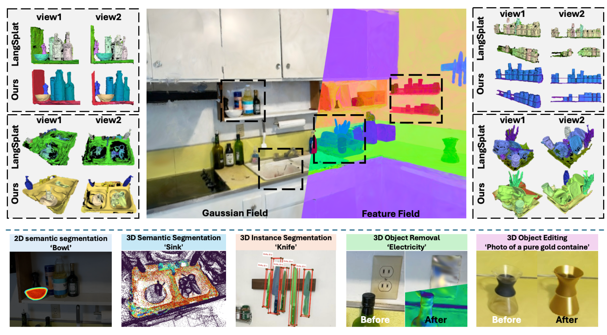

# LangSurf: Language-Embedded Surface Gaussians for 3D Scene Understanding
[Hao Li*](https://lifuguan.github.io/), [Minghan Qin*†](https://minghanqin.github.io/), , Zhengyu Zou*, Diqi He, Yongjie Zhang, [Dingwen Zhang†](https://vision-intelligence.com.cn), Junwei Han<br>(\* indicates equal contribution, † means Co-corresponding author)<br>| [Webpage](https://langsurf.github.io/) | [Full Paper](https://arxiv.org/pdf/2312.16084.pdf) | [Video](https://www.youtube.com/watch?v=XMlyjsei-Es) |<br>
| Preprocessed Dataset | [BaiduWangpan](https://pan.baidu.com/s/1S_cdmN9EFOlCQ3z1GZR3EA?pwd=lfea) | [GoogleDrive](https://drive.google.com/drive/folders/1Icw5AcQkY_2L_k7ddXrGCJ3z4laa4jg5?usp=sharing) |<br>
| Pre-trained Models | [BaiduWangpan](https://pan.baidu.com/s/12L83uEi5KlF9ViAZqp0B4w?pwd=dl22) | [GoogleDrive](https://drive.google.com/drive/folders/1ASFXWOwaXP_aSXV2iMDmEfILaDXQXlrE?usp=sharing) |<br>
| [Datasets](https://drive.google.com/file/d/1QF1Po5p5DwTjFHu6tnTeYs_G0egMVmHt/view?usp=sharing) |<br>



This repository contains the official authors implementation associated with the paper "LangSurf: Language-Embedded Surface Gaussians for 3D Scene Understanding" (Arxiv 2024), which can be found [here](https://arxiv.org/pdf/2312.16084.pdf). We further provide the preprocessed datasets, as well as pre-trained models. 

## Enviornment

We recommend `python=3.10.0`, `cuda toolkit=12.6` as the base environment. 
```bash
# SSH
git clone github.com/lifuguan/langsurf.git
cd PGSR

conda create -n langsurf python=3.10
conda activate langsurf

# compile the 3D-GS library
pip install -e submodules/diff-langsurf-rasterization
pip install -e submodules/simple-knn
pip install -e submodules/segment-anything-langsplat

# install other dependencies
pip install -r requirements.txt
```

## Data Preperation
In the experiments section of our paper, we primarily utilized two datasets: the LERF-OVS dataset and the Scannet dataset.

For the LERF-OVS dataset, we expanded upon its existing annotations, which is accessible for download via the following link: [GoogleDrive](https://drive.google.com/drive/folders/1Icw5AcQkY_2L_k7ddXrGCJ3z4laa4jg5?usp=sharing).

For the Scannet dataset, we also provided the corresponding COLMAP data. Full resources can be accessed through this link: [GoogleDrive](https://drive.google.com/drive/folders/1Icw5AcQkY_2L_k7ddXrGCJ3z4laa4jg5?usp=sharing).
### DATA Structure
```shell
data
  |---lerf_ovs
  |      |---label
  |      |     |--- ramen
  |      |     |--- ...
  |      |---ramen
  |      |     |---images
  |      |     |     |--- ...
  |      |     |---sparse
  |      |     |     |--- ...
  |      |---teatime
  |      |     |--- ...
  |      |---waldo_kitchen
  |      |     |--- ...
  |---scannet
  |      |---scene0085_00
  |      |     |---gt_iou
  |      |     |     |--- ...
  |      |     |---gt_ply
  |      |     |     |--- ...
  |      |     |---images
  |      |     |     |--- ...
  |      |     |---sparse/0
  |      |     |     |--- ...
  |      |---scene0616_00
  |      |     |--- ...
```
### For Scannet Dataset
Here we use the following scripts to convert the GT labeled point cloud into a class-specified format (for 3d evaluation).
```bash
python scripts/scannet_ply_converter.py --input_ply {path to the ply file}
# example
python scripts/scannet_ply_converter.py --input_ply data/scannet/scene0085_00/gt_ply/scene0085_00_vh_clean_2.labels.ply
```

## Training 
The bash file contains multiple steps, including image preprocess, feature inference, and Gaussian training. 
```shell
bash train_scene.sh data/lerf_ovs/waldo_kitchen
bash train_scene.sh data/lerf_ovs/ramen
bash train_scene.sh data/lerf_ovs/teatime
bash train_scene.sh data/scannet/scene0085_00
bash train_scene.sh data/scannet/scene0114_02
bash train_scene.sh data/scannet/scene0616_00
bash train_scene.sh data/scannet/scene0617_00
```

After that, the data structure should be as follows (here we take `scene0085_00` in `scannet` as examples):
```bash
data
  |---scannet
  |      |---scene0085_00
  |      |     |---images
  |      |     |     |--- ...
  |      |     |---sparse
  |      |     |     |--- ...
  |      |     |---hcma_features
  |      |     |     |--- ...
  |      |     |---hcma_features_dim3
  |      |     |     |--- ...
  |      |     |---output
  |      |     |     |---scene0085_00_1
  |      |     |     |         |---app_model
  |      |     |     |               |--- ...
  |      |     |     |         |---point_cloud
  |      |     |     |               |--- ...
  |      |     |     |         |---cfg_args
  |      |     |     |         |---chkpnt40000.pth
  |      |     |     |---scene0085_00_2
  |      |     |     |         |--- ...
  |      |     |     |---scene0085_00_3
  |      |     |     |         |--- ...
```
## Evaluation
If you already got trained model (or using our pre-trained model), you can skip the training process and directly render feature by using the following command.
```bash
bash render.sh data/lerf_ovs/waldo_kitchen
bash render.sh data/scannet/scene0085_00
```
### Compute Metrics 

For LERF-OVS Dataset, use `evaluate_lerf_ovs.py` to evalute 2D mIoU and 2D localization metrics.
```bash
python eval/evaluate_lerf_ovs.py \
         --dataset_name waldo_kitchen \
         --output_dir eval_result 
```

For Scannet Dataset, use `evaluate_scannet.py` to evalute 2D mIoU and `evaluate_scannet_3d.py` to produce 3d query pointclouds as well as evalute semantic F1-score.
```bash
python eval/evaluate_scannet.py \
         --dataset_name scene0085_00 \
         --output_dir eval_result 

python eval/evaluate_scannet_3d.py \
         --dataset_name scene0085_00 \
         --output_dir eval_result 
```
### Render 2D masks
To render 2D segmentation masks and 2D heatmap, use `--generate_mask`, as shown in the following script.
```bash
python eval/render_full.py --dataset_name teatime --output_dir eval_result --generate_mask
```

To render 3D heatmap, use `--heatmap_3d`, as shown in the following script.
```bash
python eval/render_full.py --dataset_name teatime --output_dir eval_result --heatmap_3d
```

## Downstream Tasks
### 3D Instance Segmentation
We provide 3D instance segmentation code with the following steps:

1. Run `evel/render_full.py` with argument `--ins_seg`, as shown in the following script. It will automatically generate all the object ply models (*i.e.* `teatime_ins_cookie_0_0.ply`, ...).
```bash
python eval/render_full.py --dataset_name teatime --output_dir eval_result --ins_seg
```
2. 
```bash
    python render.py -m data/lerf_ovs/teatime/output/teatime_1 \
    --include_feature --normalized \
    --ply_path eval_result/teatime/point_cloud/teatime_ins_cookie_0_0.ply
    python render.py -m data/lerf_ovs/teatime/output/teatime_1 \
    --include_feature --normalized \
    --ply_path eval_result/teatime/point_cloud/teatime_ins_cookie_0_1.ply
    python render.py -m data/lerf_ovs/teatime/output/teatime_1 \
    --include_feature --normalized \
    --ply_path eval_result/teatime/point_cloud/teatime_ins_cookie_0_2.ply
    python render.py -m data/lerf_ovs/teatime/output/teatime_1 \
    --include_feature --normalized \
    --ply_path eval_result/teatime/point_cloud/teatime_ins_cookie_0_all.ply
```

### Object Removal
To object removal, use `--remove_object`, as shown in the following script.
```bash
    python eval/render_full.py --dataset_name teatime --output_dir eval_result --remove_object
    python render.py -m data/lerf_ovs/teatime/output/teatime_3 \
    --include_feature --normalized \
    --ply_path 'eval_result/teatime/point_cloud/teatime_remove_food bag_0.ply'
```

### Object Editting and Finetune
```bash
    python gs_edit.py --dataset_name scene0617_00
    python train_finetune.py -m data/scannet/scene0617_00/output/scene0617_00_3
    python render.py -m data/scannet/scene0617_00/output/scene0617_00_3 \
    --include_feature --normalized \
    --ply_path data/scannet/scene0617_00/output/scene0617_00_3/finetune/point_cloud/iteration_43000/finetune.ply
    
```

### Object Adding
```bash
    python add.py --dataset_name waldo_kitchen --input_object_ply 'eval_result/teatime/point_cloud/teatime_food bag_0.ply'
    python render.py -m data/lerf_ovs/waldo_kitchen/output/waldo_kitchen_3 \
    --include_feature --normalized \
    --ply_path 'data/lerf_ovs/waldo_kitchen/output/waldo_kitchen_3/point_cloud/iteration_40000/add_teatime_food bag_0.ply'
```